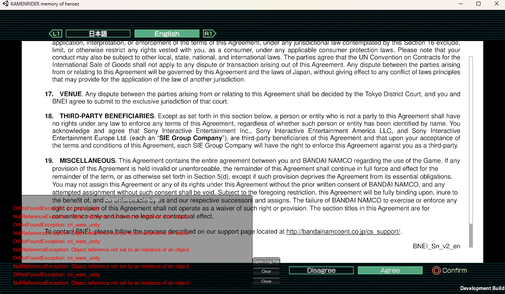
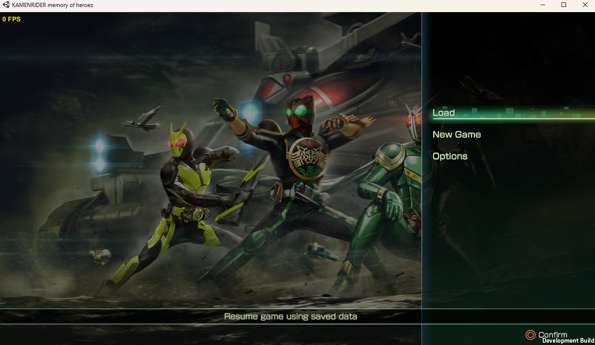

# Kamen Rider Memory of Heroez — Native Port Untuk PC

> ⚠️ **Status: Work in Progress (WIP)**
> Project ini masih dalam tahap development. Source code belum dirilis dan **belum ada build yang bisa dimainkan**.

Native port **Kamen Rider Memory of Heroez** (PS4) agar bisa berjalan langsung di PC (Windows), tanpa emulator.

## 📸 Progress Saat Ini

Game sudah berhasil masuk ke **main menu**.

## Roadmap

- [x] Boot game
- [x] Masuk main menu
- [ ] Gameplay
- [ ] Audio
- [ ] Launcher GUI (pengaturan resolusi, kontrol, dll.)
- [ ] Optimasi & perbaikan bug
- [ ] Rilis build publik

## Penting

- Repo ini **tidak menyertakan file game apa pun**. Kamu wajib memiliki game asli dan melakukan dump sendiri dari konsol milikmu.
- Jangan meminta file game atau link download di Issues maupun Discord.
- Project ini dibuat oleh fans dan **tidak berafiliasi** dengan Bandai Namco, Toei, maupun Sony.

## Komunitas

Update progress bisa diikuti di:
- Discord: *https://discord.gg/cgU8kZbQ9x*

## Kredit

Dikembangkan oleh **@IndraSundanese** (Fans Translation Supreme).

---

*Kamen Rider Memory of Heroez © Bandai Namco Entertainment / Ishimori Pro / Toei. Semua merek dagang milik pemiliknya masing-masing.*
